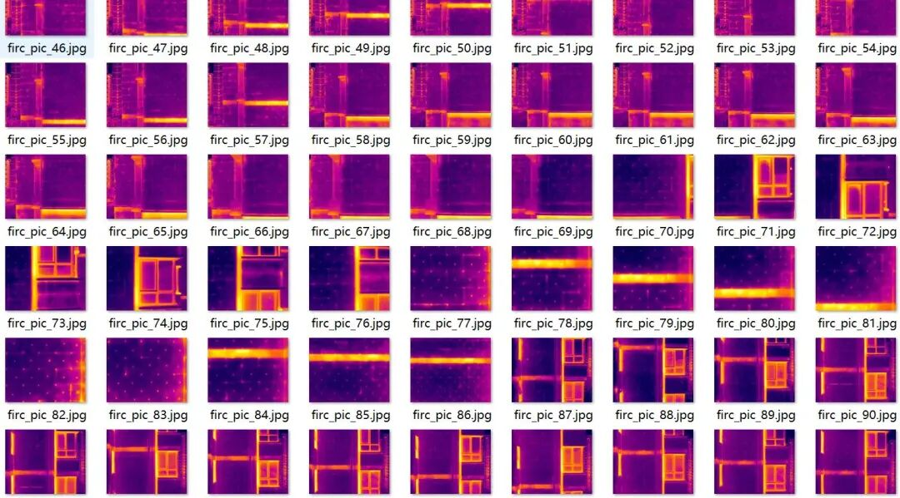
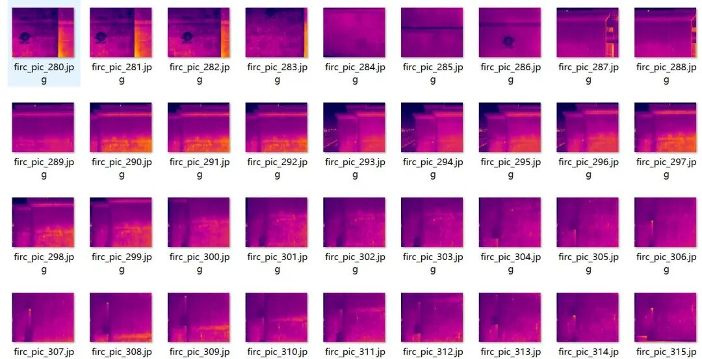
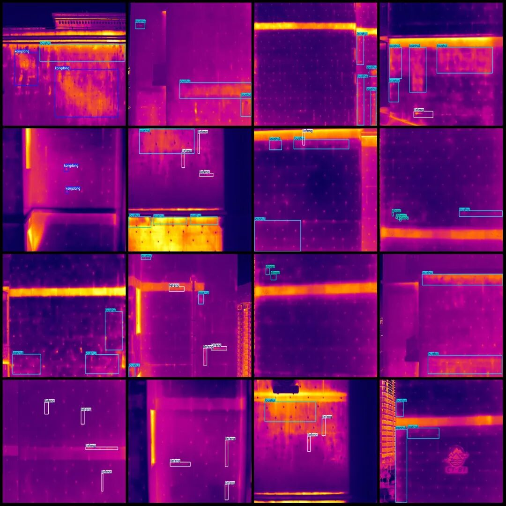
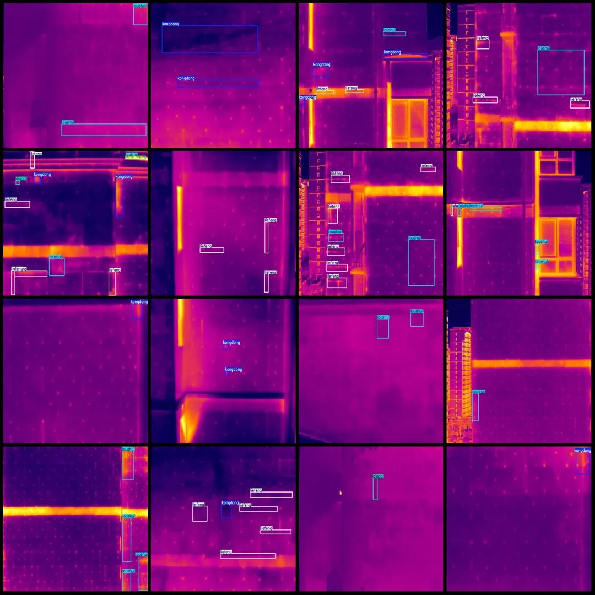

# Infrared Thermal Imaging Building Wall Defects, Cracks, Peeling, Holes, Water Leakage Detection Dataset in VOC+YOLO format with 463 images and 4 categories

Dataset format: Pascal VOC format + YOLO format (txt file without split path, only containing jpg images and corresponding VOC format xml files and yolo format txt files)

Number of images (number of jpg files): 463

Number of annotations (number of xml files): 463

Number of annotations (number of txt files): 463

Labeling category count: 4

Label category names (Note that the order of categories in the YOLO format does not correspond to this, but is based on the labels folder's classes.txt): ["diaopi", "kongdong", "liefeng", "loushui"]

Number of boxes labeled in each category:

Diaopi (skinning) frame count = 46

Kongdong (hollow) Frame Count = 196

liefeng (cracks) frame count = 798

loushui (water leakage) frame count = 493

Total frame count: 1533

Number of images per category:

Diaopi's number of images = 24

Kongdong's possession of images = 117

liefeng occupies the number of images = 256

Loushui owns 251 images.

Image resolution: 1280x1024

Using labelImg:

Annotation rules: Draw a rectangle around the category.

Important Notice: The dataset does not have separate training, validation, and test sets; you need to partition them yourself.

Special : This dataset does not guarantee the accuracy of the trained models or weight files.

Image Preview:

Annotation example:

## Payment

Here is a pay link on Stripe ( https://buy.stripe.com/3cs8yP7sY87d0vu9AB ). Please contact me lonlonago@foxmail.com after funding $89, and I will send you a complete data files , thank you!

